# Atulya Rai

> Building for the joy of it. Shipping for the thrill of it.

<picture>
  <source media="(prefers-color-scheme: dark)" srcset="./assets/profile-activity-dark.svg" />
  
</picture>
<picture>
  <source media="(prefers-color-scheme: dark)" srcset="./assets/profile-stack-dark.svg" />
  
</picture>

## Projects

### Start here

- **[Pravah](https://github.com/Snehit70/pravah)** - Timeline-based task manager with AI-agent API support. · [live](https://pravah.snehit70.dev)
- **[Kavach](https://github.com/Snehit70/kavach)** - TUI that checks every package on your laptop against vulnerability databases and updates the affected ones.
- **[Praxis](https://github.com/Snehit70/praxis)** - Exam practice platform with 127,000+ questions across 130+ courses. · [live](https://praxis.snehit70.dev)
- **[Hyprvox](https://github.com/Snehit70/hyprvox)** - One keypress, low-latency transcription: clipboard-first workflow with dual STT engines and systemd service.
- **[Aceon](https://github.com/Snehit70/aceon)** - A clean library of lectures, organized for easy access. · [live](https://aceon.snehit70.dev)

### Linux & cross-device tools

- **[Lazydev](https://github.com/Snehit70/lazydev)** - Your dev servers, on demand: auto-scale to zero, wake on request, save gigabytes of RAM.
- **[Vidyut](https://github.com/Snehit70/vidyut)** - Two-way text and screenshot sync between Linux/Wayland and Android over WiFi: end-to-end encrypted, newest copy wins.
- **[Pomo](https://github.com/Snehit70/pomo)** - Android Pomodoro timer with a decentralized focus leaderboard: no accounts, no server.

### Web apps

- **[FateWheel](https://fate.snehit70.dev)** - Real-time multiplayer roulette with a synchronized wheel, timed betting rounds, and live settlement over Socket.IO.
- **[Saksham](https://saksham-murex.vercel.app)** - AI interview practice that builds detailed, resume-specific technical interviews with real-time feedback.
- **[VoiceWeb](https://voiceweb.vercel.app)** - Browser speech-to-text that runs Whisper and Deepgram in parallel and merges the two transcripts with an LLM.
- **[GoCareer](https://gocareer.snehit70.dev)** - A student-friendly platform for exploring career paths with clarity.

Earlier work

- **[SystemdManager](https://github.com/Snehit70/systemdManager)** - Split-pane TUI for systemd user services: vim-style navigation, live log following, and service creation without leaving the terminal.
- **[Lapstat](https://github.com/Snehit70/lapstat)** - Historical Linux laptop monitor: samples CPU, memory, battery, thermals, and active apps every minute into SQLite, with a Next.js dashboard for the long view.
- **[Ralphy Monitor](https://github.com/Snehit70/ralphy-monitor)** - Live TUI for my autonomous AI coding loop: task progress, ETA, active agents, and token cost, streamed over an embedded SSE server.

